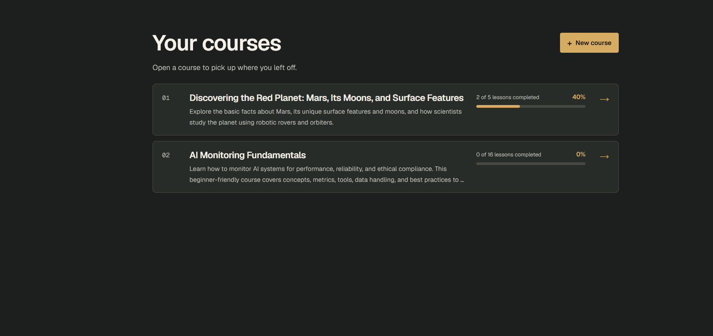

# LearnForge

LearnForge is a full-stack self-study platform. Generate a course draft with
AI from a topic or an uploaded PDF, edit it before saving, then study lessons,
take quizzes, and track your progress.

[Live demo](https://learnforge-delta.vercel.app/)


## Try the demo

1. Create an account and click **New course**.
2. Generate a course draft from a topic, such as **Introduction to Mars**.
   You can also upload a short PDF as source material.
3. Review and edit the draft, then save the course.
4. Open a lesson and mark it complete. Return to **Your courses** to see
   the progress bar update.

## Run locally

Prerequisite: Docker with Docker Compose.

1. From the directory containing `compose.yaml`, copy `backend/.env.example`
   to `backend/.env`.
2. In `backend/.env`, set `JWT_SECRET_KEY` to a random value of at least
   32 characters. Add `GROQ_API_KEY` if you want to use AI generation.
3. Start the app:

   ```sh
   docker compose up --build
   ```

4. Open [LearnForge](http://localhost:3000). The backend applies database
   migrations at startup. The [API docs](http://localhost:8000/docs) are
   available once the backend is ready.

## Tech stack

Next.js · FastAPI · PostgreSQL · Docker Compose